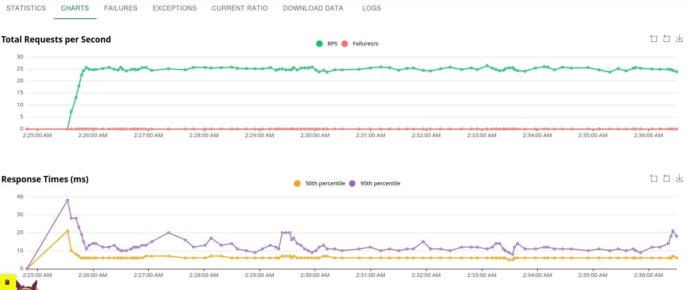
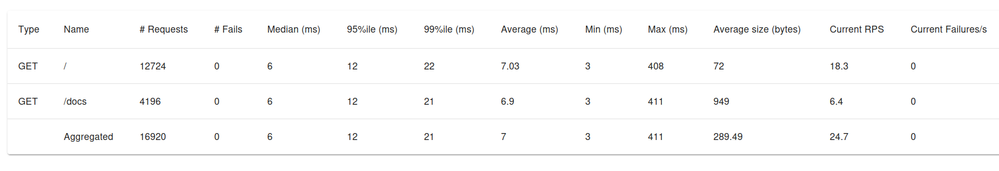

# Звіт з лабораторної роботи №4: Первинне навантажувальне тестування

## 1. Планування тестування та вибір інструменту

* **Обраний інструмент:** **Locust** (Python-орієнтований інструмент для навантажувального тестування, що ідеально підходить для стеку FastAPI).
* **Цільові ендпоінти:**
  * `GET /` (Головна сторінка / базовий API)
  * `GET /docs` (Інтерактивна документація Swagger UI)
* **Профіль навантаження:**
  * Кількість віртуальних користувачів (VUsers): до 50
  * Швидкість розгону (Ramp-Up): 5 користувачів за секунду
  * Тривалість тесту: ~12 хвилин

## 2. Створення та запуск сценарію

Сценарій тестування реалізовано у файлі `load_tests/locustfile.py` за допомогою класу `HttpUser` із використанням затримок `between(1, 3)` для імітації реальної поведінки користувачів. Тестування виконувалося на локально розгорнутому через Docker Compose середовищі проєкту **Synclone**.

## 3. Збір первинних метрик

### Динаміка навантаження (Графіки Locust)
Нижче наведено графіки динаміки пропускної здатності (RPS) та часу відповіді (p50, p95), зафіксовані під час тестування:

### Підсумкова таблиця метрик (Locust Statistics)
Статистика виконання запитів за результатами тесту:

| Type | Name | # Requests | # Fails | Median (ms) | 95%ile (ms) | 99%ile (ms) | Average (ms) | Min (ms) | Max (ms) | Current RPS | Error Rate |
| --- | --- | --- | --- | --- | --- | --- | --- | --- | --- | --- | --- |
| GET | `/` | 12724 | 0 | 6 | 12 | 22 | 7.03 | 3 | 408 | 18.3 | 0% |
| GET | `/docs` | 4196 | 0 | 6 | 12 | 21 | 6.9 | 3 | 411 | 6.4 | 0% |
| **Aggregated** | **-** | **16920** | **0** | **6** | **12** | **21** | **7** | **3** | **411** | **24.7** | **0%** |

### Ресурси сервера (`docker stats`)
Під час пікового навантаження споживання ресурсів контейнерами склало:
* **`web-1` (FastAPI):** CPU: ~6% | MEM: 92 MiB
* **`prod-web-1` (Web/Proxy):** CPU: ~0.25% | MEM: 62 MiB
* **`prod-db-1` / `db-1` (PostgreSQL):** CPU: ~0.01% – 6.23% | MEM: 20–25 MiB

## 4. Висновки та виявлені «вузькі місця»

1. **Стабільність системи:** На поточних рівнях навантаження (близько 25 RPS) архітектура проєкту Synclone демонструє надзвичайно високу стійкість. Час відповіді залишається стабільним (медіана 6 мс, 95-й перцентиль — 12 мс).
2. **Відсутність помилок:** Error Rate дорівнює 0%, що свідчить про коректну обробку асинхронних запитів у FastAPI та відсутність витоків з'єднань з базою даних.
3. **Вузькі місця (Bottlenecks):** Оскільки поточне навантаження є базовим для перевірки готовності інфраструктури, значних деградацій чи різкого зростання затримок не виявлено. При подальшому масштабуванні тесту (понад 500+ RPS) першими точками навантаження потенційно стануть пули з'єднань бази даних (`SQLAlchemy AsyncSession`) або обмеження введення-виведення диска для MinIO.